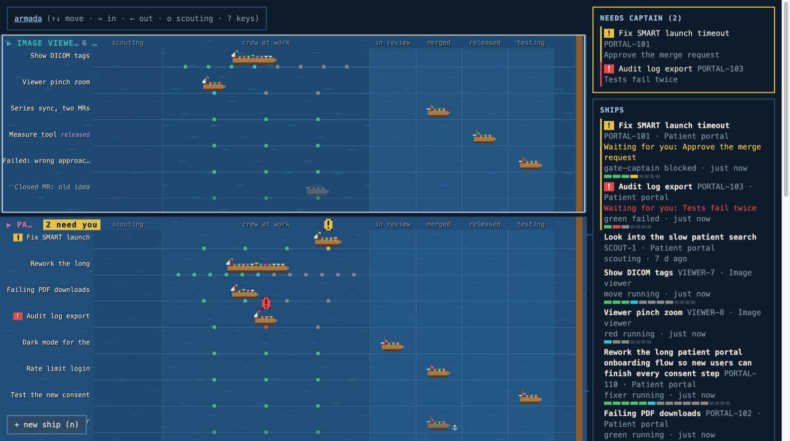
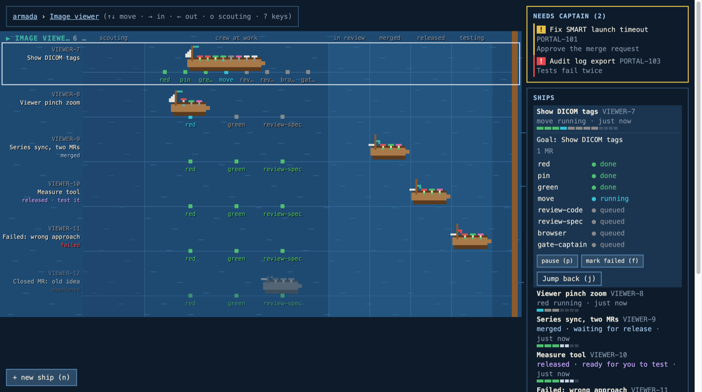
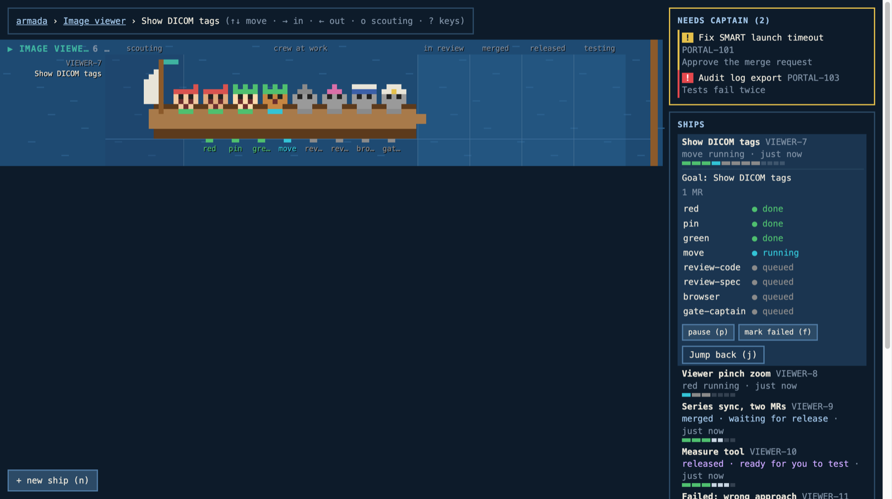
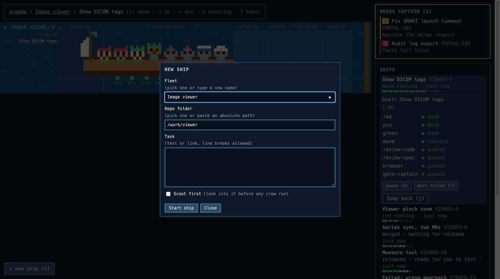

# Fleet

Fleet is a local web page. It shows every crew ship, grouped by fleet (project). The captain can go back to any ship from it.

This repo also holds [crew](crew/README.md), the Claude Code mod and skills that run each ship.

Zoom in with → and out with ←. There are three levels.

**Armada:** all fleets. The "Needs captain" panel lists the ships that wait for you.



**Fleet:** one fleet. The role names show under each ship.



**Ship:** one ship and its crew. The side panel shows each role and its state.



## Run

```
npm start -- --port 4932
```

Needs Node 22.18 or newer. No install step. `npm run demo` starts it with fake data. `npm test` runs the tests.

Fleet reads ships from `~/.crew` and keeps its own files in `~/.fleet`. Set `CREW_BOARD_ROOT` or `CREW_FLEET_HOME` to use other folders.

Fleet keeps its token in `~/.fleet/token`. So open tabs keep working after a restart. Delete the file to get a new token.

## Start at login

Fleet can start when you log in to the Mac. A launchd agent does this. It also restarts fleet after a crash. It does not restart fleet after a clean stop.

Make the log folder first: `mkdir -p ~/.fleet`. Then save this as `~/Library/LaunchAgents/com.salihsayer.crew-fleet.plist`. Change `<you>` to your user name. launchd does not expand `~`, so write full paths.

```xml
<?xml version="1.0" encoding="UTF-8"?>
<!DOCTYPE plist PUBLIC "-//Apple//DTD PLIST 1.0//EN" "http://www.apple.com/DTDs/PropertyList-1.0.dtd">
<plist version="1.0">
<dict>
  <key>Label</key>
  <string>com.salihsayer.crew-fleet</string>
  <key>ProgramArguments</key>
  <array>
    <string>/bin/zsh</string>
    <string>-lc</string>
    <string>exec node bin/crew-fleet.ts</string>
  </array>
  <key>WorkingDirectory</key>
  <string>/Users/<you>/Private/fleet</string>
  <key>RunAtLoad</key>
  <true/>
  <key>KeepAlive</key>
  <dict>
    <key>SuccessfulExit</key>
    <false/>
  </dict>
  <key>StandardOutPath</key>
  <string>/Users/<you>/.fleet/fleet.log</string>
  <key>StandardErrorPath</key>
  <string>/Users/<you>/.fleet/fleet.log</string>
</dict>
</plist>
```

The login shell gives fleet your normal `PATH`. So fleet finds `node`, `glab`, `gh` and `herdr`. Fleet uses the default port 4932.

Load it:

```
launchctl bootstrap gui/$(id -u) ~/Library/LaunchAgents/com.salihsayer.crew-fleet.plist
```

Unload it:

```
launchctl bootout gui/$(id -u) ~/Library/LaunchAgents/com.salihsayer.crew-fleet.plist
```

If port 4932 is taken, a new copy prints `crew-fleet: fleet already runs at http://127.0.0.1:4932`. It then exits with code 0. launchd does not restart it.

## Search and filter

The box at the top of the right column finds ships. Press `/` to type in it. Keys do nothing else while you type.

A ship matches when the text is part of its name, title, task link, MR number (`561` or `!561`), MR link or branch. Case does not matter. Search also finds ships that the harbour hides.

Under the box, one row of chips filters by state. Only one chip is on. Each chip shows how many ships match it, and the counts follow the search text.

| Chip | Ships it shows |
| --- | --- |
| `all` | Every ship. This is the default. |
| `needs you` | Ships that wait for you. |
| `running` | Ships at sea that do not need you. Scouts that still scout count here. |
| `stale` | Ships with a crew member that has not reported for 15 minutes. |
| `in review` | Ships in review. |
| `merged` | Merged or released ships. They wait for your test. |
| `testing` | Ships you are testing. |
| `done` | Done ships, and scouts that turned back. |
| `paused/failed` | Paused, failed or abandoned ships. |

While you search or filter, the right column shows one list of the matching ships. Click a row, or press `Enter` to open the highlighted row. Use `↑` and `↓` in the box to move the highlight. On the sea, ships that do not match are hidden. The other ships close up the gaps. A fleet with no match hides its lane. If the cursor was on a hidden ship, it moves to the first fleet. `Esc` clears the text. The text and the chip are not kept over a reload.

## Automatic states

Every 2 minutes, fleet checks each MR that is `in_review`. It runs `gh pr view <url> --json state,mergeCommit` for GitHub links. It runs `glab mr view <url> --output json` for all other links. A merged MR becomes `merged` and keeps its merge SHA. An MR closed without a merge becomes `abandoned`. If the CLI is missing or fails, the page says so. The captain then uses the buttons.

Every 2 minutes, fleet also runs the fleet's `release_check` for each `merged` MR. Exit code 0 moves the MR to `released`. Any other result keeps it `merged`. The page shows the last result.

## New ship

The "+ new ship" button opens a form with three fields: fleet, repo folder and task. A "Scout first" checkbox under Task starts a scout in place of a crew run. The task can have several lines, up to 4000 characters. Other control characters are refused. Fleet checks them on the server. The folder must exist and be a git repo. If it is a worktree, fleet uses the main checkout.

Fleet starts `claude --session-id <uuid> -n <ship> "/crew <task> fleet: <fleet>"` in a new herdr tab in the fleet's workspace. With "Scout first" ticked, the prompt is `/scout ...` and the tab name gains a `scout-` prefix. It then focuses the tab and raises Ghostty. If herdr does not answer, the page shows the command to copy. Fleet writes no ship file. The ship shows on the sea when crew writes its `ship.json`.



## Scouts

A scout is a Claude session that looks into a bug report before any crew run. Crew writes the scout's file. Fleet only reads it.

Fleet reads two top-level fields from `~/.crew/<ship>/ship.json`:

- `kind`: `"ship"` or `"scout"`. A missing field means `"ship"`.
- `outcome`: one line, or `null`. A missing field means `null`.

A scout with no MRs sails in the scouting band, a strip on the left of each lane. Its boat has no sail, because it has no crew. It flies a small flag in the fleet colour, so it reads at a glance. Press `o` to turn the band on or off. The band is on by itself when a scout is at sea. The key is not kept over a reload.

A scout with no MRs and an outcome is turned back. Fleet docks it in the harbour on its own, and the harbour row shows the outcome line. A scout that gains MR 1 is a normal ship from then on.

## fleets.json

File: `~/.fleet/fleets.json`. The captain or an agent edits it. Fleet reads it again on every request, so no restart is needed.

It is one JSON object. Each key is a fleet id (the `fleet` field of `ship.json`). Each value has these optional fields:

- `name`: the name shown on the page. Default: the fleet id.
- `color`: any CSS colour. Default: a colour made from the id.
- `release_check`: a shell command. Fleet runs it with `/bin/sh -c`. Leave it out to mark `released` by hand.
- `repos`: a list of absolute folder paths. The "new ship" form shows them first, then the repos of past ships. Entries that are not absolute paths are ignored. If the fleet has only one repo choice, the form fills it in. Fleet still checks the chosen folder when a ship starts.

```json
{
  "portal": {
    "name": "Patient portal",
    "color": "#d96fa8",
    "repos": ["/Users/me/code/portal", "/Users/me/code/portal-infra"],
    "release_check": "git fetch origin main && git merge-base --is-ancestor \"$FLEET_SHA\" origin/main && curl -fsS https://portal.example.com/version | grep -q \"$FLEET_SHA\""
  },
  "viewer": {
    "name": "Image viewer",
    "color": "#3fb3a0"
  }
}
```

### release_check rules

- Exit code 0 means "this change is released". Any other code means "not yet".
- The limit is 60 seconds. After that, fleet kills the command and everything it started.
- The working folder is the MR worktree. If that folder is gone, it is your home folder.
- Fleet sets these variables. Use them in the command. Fleet never puts them inside the command text.

| Variable | Meaning |
| --- | --- |
| `FLEET_SHA` | The merge commit SHA. Empty if the captain marked the MR merged by hand. |
| `FLEET_REPO` | Path of the repo. |
| `FLEET_REMOTE` | The git remote of the repo. |
| `FLEET_BRANCH` | The MR branch. |
| `FLEET_MR_URL` | The MR link. |

Always put the variables in double quotes, as in the example.

## Keys

Keys act on the open ship: the one under the cursor, or the one opened in the harbour. A key works only when its button shows for that ship. Keys do nothing while you type in a form field. Each button shows its key.

| Key | Action |
| --- | --- |
| `j` | Jump back |
| `s` | Next state: mark merged, mark released, start testing or done |
| `p` | Pause, or resume |
| `f` | Mark failed. Press twice to confirm. |
| `b` | Bug found, back to sea. Press twice to confirm. |
| `u` | Undock |
| `n` | New ship |
| `/` | Search ships. `Esc` clears the text and leaves the box. |
| `o` | Show or hide the scouting band |
| `?` | Show or hide the key list |

The arrow keys, `Enter` and `Esc` move the cursor and zoom. The "press again to confirm" prompt ends after 4 seconds, or when you press another key.
