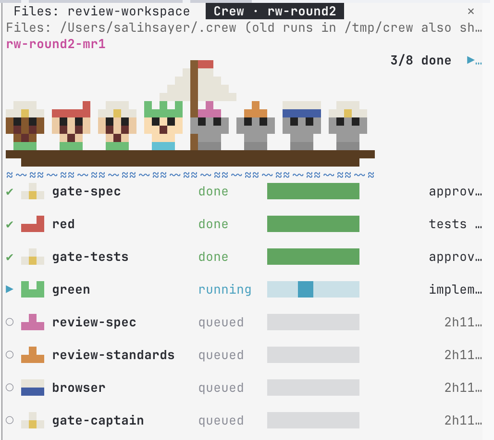
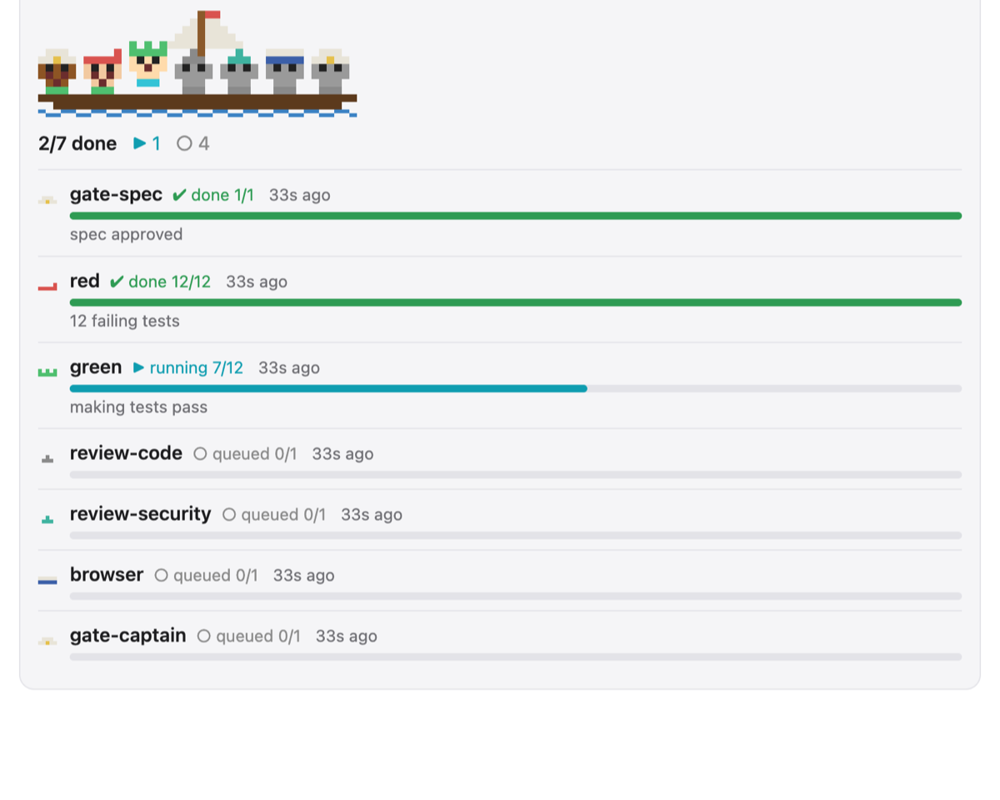
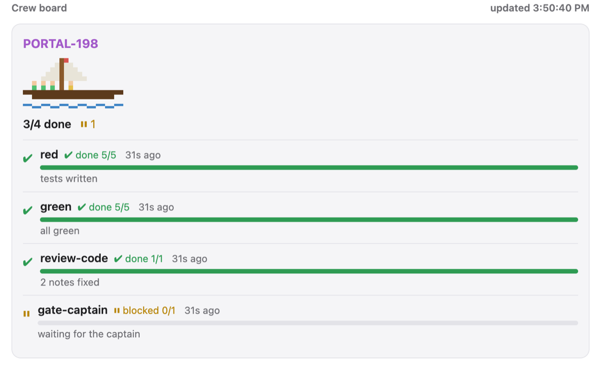

# crew-board

A Claude Code mod. It shows a live board of the agents in a `/crew` run.
It only reads. It never writes the status files.



## Install

In a Claude Code session:

```
/plugin install crew-board --marketplace sabasayer/fleet
```

To try it from a local clone of fleet, without install:

```sh
claude --plugin-dir ./crew/mods/board
```

## Use

Type `/crew-board`. A pane opens. It checks `~/.crew` every 2 seconds.
No refresh needed.

- One block per ticket (a folder in `~/.crew/`). The newest ticket is first.
- Each ticket has a tiny pixel ship (half-block characters in the terminal, an SVG in the desktop app). One crew member stands on deck for each agent, colored by state.
  The ship bobs and the sea moves while an agent runs and is not stale. Crew members of running agents hop.
  A stale or idle ship stays still. The flag turns green when all agents are done and red if one failed.
- A summary beside the ship shows the counts, like `3/8 done  ▶ 2  ⏸ 1`. The rows are in chain order, top to bottom.
- One row per agent: role, state, bar, count, phase, time since the last update.
- A `running` agent with no update for 15 minutes shows in red with `STALE`.
- A file that is not valid JSON shows as `unreadable`.

Show one ticket only: `/crew-board <ticket>`, for example `/crew-board eng-708-mr2`.
Type `/crew-board` with no name to see all tickets again.

The first mate can open the board itself. The mod gives it a tool,
`mcp__crew-board__crew_board_open`, with one input: `ticket`.
Claude asks you once to allow it. Allow it for the session or always.

The board folder is `~/.crew`. The mod creates it. It survives a restart.
Set `CREW_BOARD_ROOT` to use another folder.
The board also shows old runs in `/tmp/crew`. The header shows the folder path.

Type `/crew-board clean` to list runs older than 30 days. Nothing is deleted.
Type `/crew-board clean yes` to delete them. It only cleans the board folder, never `/tmp/crew`.

## The crew skill

The plugin also ships a skill: `/crew-board:crew`. It is the first mate.
It runs a ticket through spec, tests, code, review and ship, with gates for you.
It writes the status files that the board shows. It reads your project docs for the dev server, the checks and the ship flow.
The skill and its briefs are in `mods/board/skills/crew/`.

The crew skill has a lean mode: ticket, one builder, prove, captain test, push.
It skips the spec gate and review. Use it for prototypes, game toys, solo repos and small fixes.
Ask for it by name, for example `/crew-board:crew lean`.

The plugin ships `/crew-board:game-prototype` too. It runs a game prototype from idea to findings.
It grills the idea, plans small toys, scaffolds a pure sim with a bot playtester, and builds each ticket with lean crew.
After each playtest it logs the feedback and grills the next step. It ends with a findings doc and a plan for the real game.

The plugin ships a second skill: `/crew-board:prove`. It runs the checks CI runs before a branch ships. The first mate runs it once, after review.

A third skill is `/crew-board:scout`. It looks into a bug report before a crew run.
A scout is a ship with no merge request yet. It finds the cause and writes `~/.crew/<ship>/scout.md`.
It never edits a repo file. Found work? It hands over to `/crew`, which reads that file.
Nothing to fix? It leaves a one-line outcome and stops.

The crew skill has a file `e2e.md`. It lists what every e2e run must do. Agents then find the repo's own e2e scripts that do it.

The plugin has a `bin` folder with three commands. Claude Code puts it on the PATH of the Bash tool when the plugin is on. A session loads it at the start.

- `crew-status <role> <state> "<summary>" --run <run folder> [--order N]` writes a status file. It refuses an empty summary for `blocked`, `done` and `failed`.
- `crew-ship` writes the ship file `~/.crew/<ship>/ship.json` (fleet, title, task link, kind, outcome, session, MRs). The board skips it. See `skills/crew/status.md`.
  `crew-ship scout <ship> --title T --fleet F` starts a ship with no MR. `crew-ship outcome <ship> "<one line>"` sets the result of a scout.
  `kind` is `"ship"` or `"scout"`. `outcome` is the one-line result, or `null`.
- `crew-visual-diff <test-results folder>` prints the changed pixels and the changed area of each Playwright `*-actual.png` and `*-expected.png` pair. Agents read this text and do not open the images.

## Web view (browser or phone)

`/crew-board serve` starts a small web server and prints the links:

```
crew-board http://192.168.1.20:7777/?t=Xk3...
```

Open one on any device in the same network. The page shows the same board: ship, agents, bars, stale and blocked states. It polls every 2 seconds and moves the ship while an agent runs.



- The link has a random token. Without it the server answers 403. It is made fresh at each start.
- `/crew-board serve local` listens on this computer only. `/crew-board serve stop` stops it. It also stops when the session ends.
- Change the port with the `port` option. The default is 7777.
- It shows the same folders as the pane: the board folder, and old runs in `/tmp/crew`.
- It needs Node 22.18 or newer. You can also run it alone: `node mods/board/serve/serve.mjs --port 7777 [--local-only] [--root ~/.crew] [--token abc]`.
- Add `&ticket=<name>` to show one ticket, or `&style=simple` for the simple ship.
- Anyone on your network with the link can see ticket names and phases. It is plain HTTP. To reach it away from home, use a VPN such as Tailscale and open the Tailscale address (it is in the printed list). Do not open the port to the internet.

## Alerts

When an agent becomes `blocked` (a gate waits for the captain), `failed`, or stale, the mod sends a notification through your Claude Code notification channel. Each change is sent once. Start-up state is not sent. Turn it off with the option `alerts` set to `off`.

## Mobile app

The Claude mobile app does not dock panes, so the pane does not show there. The mod draws a short summary above the prompt instead: the newest ticket, the done count, and the agents that are running, blocked or failed. This follows the mod API for the `mobile` surface. It has not been tried in the app yet.

## Style (option)

The option `style` is `full` or `simple`. The default is `full`.
- `full`:
  - Each agent is a small pixel face with a hat on the ship, up to 8.
  - The hat shape follows the role: captain cap for `gate-*`, bandana for `red` and `pin`,
    tricorn for `green` and `move`, pointed hat for `review-*`, hard hat for `fixer`,
    sailor cap for `browser`, plain cap for any other role.
  - The hat color is fixed for `red`, `green`, `fixer`, `gate-*` and `browser`.
    Other roles get a color from their name. So two `review-*` agents get different colors.
  - The face shows the state: smile when done, frown when failed, flat mouth when blocked,
    small mouth when running, gray face when queued. A running face hops.
    The collar has the state color. A stale agent has a red collar.
  - Each agent row shows the hat before the role name: 3 by 2 pixels in the terminal, 5 by 2 in the desktop app.
  - `simple`: each agent is a small one-pixel crew member on the deck. No hats, no faces,
  and the rows are compact.



Switch it with a command. The pane changes at once, and the choice is kept for the next sessions:

- `/crew-board style` switches between `full` and `simple`.
- `/crew-board style simple` or `/crew-board style full` picks one.

The command wins over the setting. The setting is the default for a new install. Change it in the plugin settings, or in `~/.claude/settings.json`:

```json
{ "pluginConfigs": { "crew-board": { "options": { "style": "simple" } } } }
```

The older option `characters` is gone. It is ignored if it is still in your settings.

## Status file contract

One file per agent: `~/.crew/<ticket>/<role>.json`. Agents write it with `crew-status`.

```json
{"role":"red","state":"running","phase":"writing e2e tests","done":12,"total":35,"order":2,"updated":"2026-10-16T14:40:00Z"}
```

| Field | Needed | Meaning |
| --- | --- | --- |
| `role` | no | Name on the board. The file name is used if missing. |
| `state` | yes | `queued`, `running`, `blocked`, `done` or `failed`. |
| `phase` | no | What the agent does now. |
| `done`, `total` | no | Progress. Without them the bar is a moving block. |
| `summary` | no | Short result text. On `done` or `failed`, the board shows it in place of `phase`. |
| `updated` | yes | ISO time of the last write. |
| `order` | no | Place in the chain. Lower comes first. |

The mod shows any `*.json` file. It does not need a fixed list of roles.
Without `order`, it sorts by the usual flow:
`gate-spec, spec, spike, red, pin, gate-tests, green, move, review-*, fixer, browser, gate-captain`.
Unknown roles go last.

## Develop

Run these from the `crew` folder.

```sh
claude plugin validate mods/board
claude plugin test mods/board
python3 mods/board/test/crew_ship_test.py
```

The tests cover the logic in `mods/board/hooks/board.ts` and `ship.ts`: stale check, chain order,
bad JSON, bar and age, alerts, ship shape, hats and faces. The web server is not tested by a script; start it with demo files and open it. The pane drawing is not tested by a script. Check it by eye with demo files:

```sh
mkdir -p ~/.crew/demo && echo '{"role":"red","state":"running","phase":"demo","done":3,"total":10,"updated":"'$(date -u +%FT%TZ)'"}' > ~/.crew/demo/red.json
```

## Move this mod

The mod is one folder: `mods/board`, with its hooks and its skills. It does not use mr-triage or any server.
To merge it with other mods, copy that folder and add a line to the other repo's
`.claude-plugin/marketplace.json`. Here that file is at the root of the fleet repo.
